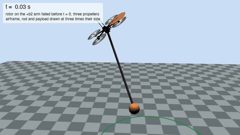

# Quasi-Static Fault-Tolerant Feedback Control of a Quadrotor Carrying a Slung Payload under Rotor Failure

Mohamed Al Lawati (Sultan Qaboos University) and Adeel Akhtar (New Jersey Institute of Technology).

**Project page: https://gradslab.github.io/qs-sl/**

A quadrotor carries a payload on a massless rod pivoted at its center of mass. One rotor has failed completely,
so three propellers remain and the roll torque is tied to the thrust and the yaw torque. The controller is a
quasi-static feedback designed for the faulty dynamics. It drives the payload onto a geometric path in space,
keeps the path invariant, assigns the motion along it and keeps the yaw rate of the airframe bounded. The
airframe spins about its vertical axis for the whole flight, as three propellers cannot hold the yaw, while the
payload converges to a horizontal circle and settles at the commanded speed.

<p align="center"></p>

## What is here

```
docs/     the project page: animations, the figures of the paper, the run that starts on the path, parameter tables
sim/      the Python port of the controller, the Drake simulation and the figure scripts, with its own README
matlab/   the MATLAB implementation of the paper, with the expressions generated by Maple
assets/   the Skydio X2 mesh of the MuJoCo Menagerie (Apache-2.0) and its license
```

`sim/README.md` gives the commands that regenerate every result, starting with the verification gates. The
project page is built from those outputs by `sim/web/build_page.py`, and no number on it is written by hand.

## Citation

```bibtex
@unpublished{allawati2026quasistatic,
  author = {Mohamed Al Lawati and Adeel Akhtar},
  title  = {Quasi-Static Fault-Tolerant Feedback Control of a Quadrotor
            Carrying a Slung Payload under Rotor Failure},
  note   = {Under review},
  year   = {2026}
}
```
